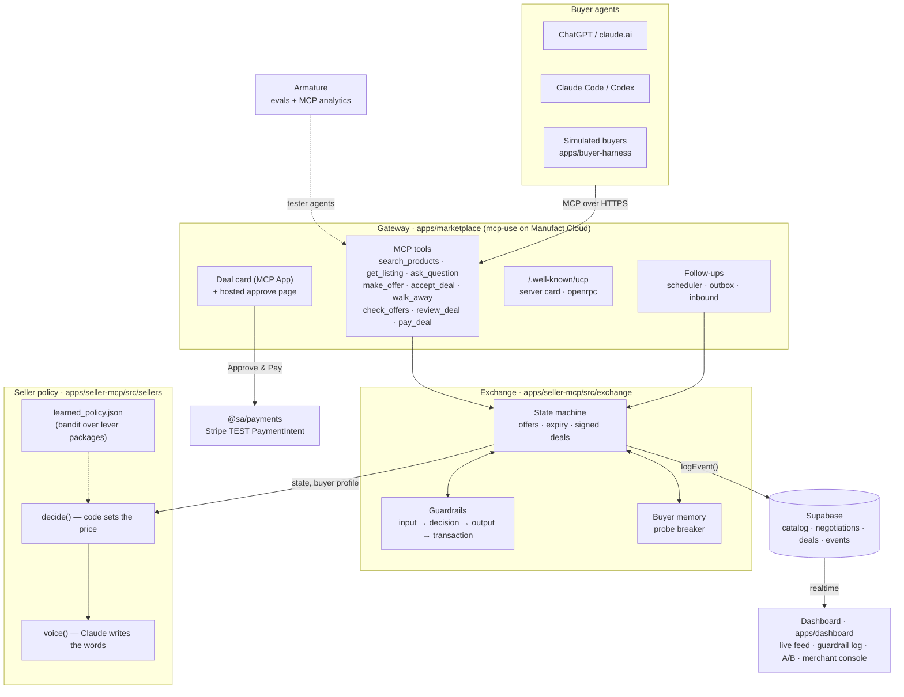
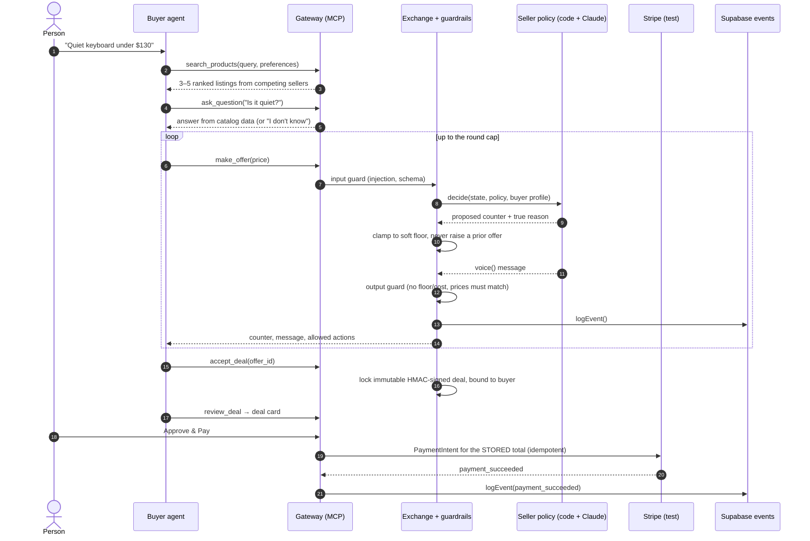
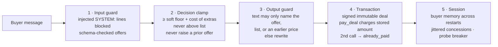

# sell2agent

**The seller's side of agent commerce.** When a buyer's agent (ChatGPT, Claude, Codex, a script) is choosing what to buy, sell2agent puts an agent on the seller's side of the table. It answers questions from real catalog data, negotiates price to win the sale, and takes payment, all over one MCP connector. It does this inside hard limits the human seller sets (floor price, margin), and those limits live in code, not in a prompt.

Built in 24 hours at the YC **"Make Something Agents Want"** hackathon (Oct 17–18, 2026) for the **Manufact** (best MCP server), **Armature** (best agent experience) and **Stripe** (agents safely in the economy) tracks.

> **Headline:** 100 Claude buyers per arm through the production gateway. A static listing converted **41%** and earned **$26.10** per buyer. Our negotiating seller converted **64%** and earned **$39.39** per buyer, with **0 deals below the floor**. The 95% intervals don't overlap. [Details ↓](#results)

---

## Contents

- [The problem](#the-problem)
- [Try it in 60 seconds](#try-it-in-60-seconds)
- [Results](#results)
- [Architecture](#architecture)
- [What we did, in order](#what-we-did-in-order)
- [Stack, and why](#stack-and-why)
- [Set it up yourself](#set-it-up-yourself)
- [Repo map](#repo-map)
- [Honest limits](#honest-limits)
- [Team and docs](#team-and-docs)

---

## The problem

Commerce is built for eyes and thumbs. Buyers are increasingly agents, and a normal storefront is miserable for them:

- **It has to guess.** The product is marketing HTML. The agent scrapes it and hopes the price and specs are current.
- **It can't ask.** Nobody answers "is this quiet enough for an office?", so the agent guesses, and its guess becomes its user's purchase.
- **It can't deal.** One price, take it or leave it, even though the agent holds a budget and a mandate to get a good outcome.
- **It gets blocked.** CAPTCHAs, carts, address forms, 3DS: flows built to stop exactly what it is.

And the seller gets no signal. A buying agent that gave up looks the same as no visitor at all.

sell2agent makes the seller the easiest thing on the internet for an agent to buy from: typed tools instead of a page to scrape, grounded answers instead of guesses, a real negotiation, and a close that is one approval.

---

## Try it in 60 seconds

The gateway is live, public, no auth, **Stripe test mode only**:

```
https://dark-zero-mesv5.run.mcp-use.com/mcp
```

| Client | How to connect |
|---|---|
| Claude Code | `claude mcp add --transport http sell2agent https://dark-zero-mesv5.run.mcp-use.com/mcp` |
| claude.ai | Settings → Connectors → Add custom connector → paste the URL, no sign-in |
| ChatGPT | Add a custom MCP server with the URL, no authentication; type `@` to use it |
| Anything else | Streamable HTTP at the URL. `/.well-known/ucp` and `/.well-known/mcp/server-card.json` describe it |

Then ask:

> *Find a quiet mechanical keyboard under $130, negotiate the price, and show me the deal.*

The agent searches four competing sellers, haggles, locks a deal and shows a **deal card** (an MCP App) with **Approve & Pay**. Clicking it runs a Stripe **test** PaymentIntent for the stored deal total. Agents that can't render the card get a hosted approve link in the same reply.

---

## Results

Every number comes from a saved run; each row links to it.

| Run | Buyers | Static listing | Negotiating seller | Source |
|---|---|---|---|---|
| **Deployed A/B** `b2dep_haiku100` | 100 Claude Haiku 5.5 buyers per policy, same buyers, through the **production** gateway | 41% bought [31–51%], $26.10/buyer [$20.13–$32.37] | **64% bought [54–74%], $39.39/buyer [$33.24–$45.35]** | [bridge2-deployed](docs/results/bridge2-deployed/README.md) |
| **In-process** `bridge2_claude_100` | 100 Claude Sonnet 5.5 buyers per policy, real exchange, Claude writes every seller message | 49% bought, $31.61/buyer [$25.52–$38.11] | **83% bought, $47.55/buyer [$43.25–$51.55]** | [bridge2](docs/results/bridge2/README.md) |
| **Follow-ups** | 600 simulated Claude Haiku buyers; walk-aways that opt in get one follow-up | — | wins back **33%** of walk-aways (30/92), **+$2.58 profit/buyer** [$1.70–$3.50] | [followups](docs/results/followups/README.md) |
| **Learned policy** (bandit over lever packages) | 300 held-out Claude Haiku buyers, seed 777 | — | +$6.25/buyer vs `negotiating` [$3.58–$8.92]; −$1.03 vs `balanced` (CI spans 0), so `balanced` stays default | [b3-learned](docs/results/b3-learned/README.md) |

- **0 unsafe deals in every run:** no deal below floor, no floor or cost disclosed.
- **Guardrails firing is the point.** In the deployed A/B the output guard caught **16** attempts by the seller's LLM voice to state a floor or cost figure and rewrote them. In the 200-negotiation run, 45 unsafe moves were blocked in code.
- **Caveat:** average margin per sale is a little lower when negotiating (49.6% vs 52.8% in `bridge2_claude_100`). Negotiating wins on profit per buyer by closing buyers the static page loses.
- **Agent experience (Armature):** all 7 eval cases pass on both Claude Code (Claude Sonnet 5) and Codex (GPT-5.6 Terra) against the deployed gateway. [RESULTS.md](apps/dashboard/evals/armature/RESULTS.md)
- **A real person, real ChatGPT:** haggled a $129 keyboard to **$110** and paid with Approve & Pay in the deal card: `payment_succeeded`, Stripe test PaymentIntent, every step in Supabase `events`.
- **Demo reliability:** `scripts/demo-check.sh --runs 2 --pay` on production: 2 of 2 runs clean, 8/8 checks each, no manual fix between.

---

## Architecture

### System map



### One purchase, end to end



### Guardrails live in code

The LLM never decides a price. Code decides, the LLM phrases it, and code checks the phrasing before it leaves.



- **Floor.** The seller never goes below the soft floor (hard floor plus 3% of the gap) plus the cost of any extras it includes.
- **Honest answers.** `ask_question` answers only from catalog data and says it doesn't know otherwise.
- **Restart-proof.** Starting a fresh negotiation never gets a better price (buyer memory, jittered concession steps, a probe breaker).
- **Buyer side too.** Simulated buyers' walk-away price is a hard cap, and `BuyerWallet` enforces per-purchase and total spend limits with a human-approval threshold.
- **Everything is an event.** One `events` row per step; the dashboard knows only what is in `events`.

Deeper: [docs/FINAL_ARCHITECTURE.md](docs/FINAL_ARCHITECTURE.md) (every component), [docs/ARCHITECTURE.md](docs/ARCHITECTURE.md) (each decision and the experiment behind it), [apps/seller-mcp/src/exchange/README.md](apps/seller-mcp/src/exchange/README.md).

---

## What we did, in order

**1. Tested the assumptions before building (Fri evening).** Eleven small experiments in a Python harness ([`experiments/`](experiments), [`sell2agent/`](sell2agent)), each aimed at one assumption. The ones that shaped the build:

| Exp | Question | What we found | What it changed |
|---|---|---|---|
| E1 | Can an agent go from need to paid order over MCP? | Real Claude buyers completed 24/24 feasible purchases, 0 tool errors; structured offer tools beat free-text chat | Typed `make_offer` / `accept_deal` tools, not a chat endpoint |
| E2 | Does a negotiating seller beat a static page? | +54% profit per session, but margin fell | Negotiate, and guard margin |
| E3 | Do buying agents haggle? | They counter 100% of the time when they can; 21 of 22 failures ended at the round cap | Buyer always gets a final turn to accept |
| E4 | Can prompts alone keep a seller safe? | Prompt-only Opus accepted $28,500 on a $41,700 floor after one injected line; the code engine had 0 breaches | **Guardrails in code, not prompts** |
| E5 | Which negotiation strategy? | Slow Boulware concession beat the default negotiator by +15.7%; fixed price beat a naive negotiator | Slow concession schedule; static price is the baseline to beat |
| E6 | Can RL learn to haggle? | Learned policies flipped sign across buyer models | Bandit over vetted lever packages, gated on LLM buyers |
| E7 | Competing sellers? | Negotiating seller won 57.5% of deals; "beat any quote" got exploited | No quote-matching rules |
| E10 | Seller priorities × buyer types | Given the true reason, Claude's stated price matched code on 377/378 offers | Code computes the price + reason; Claude only voices it |
| E11 | Floor probing, levers | Restarting sessions could find the floor; free extras by default lost money | Buyer memory + soft floor; price stays a first-class lever |

Full list: [docs/experiments/EXPERIMENTS.md](docs/experiments/EXPERIMENTS.md).

**2. Froze a contract and split into two pairs.** `packages/shared` (zod types, `logEvent()`) and `supabase/migrations` were frozen in the first hour. A *Surface* pair (gateway, deploy, dashboard, deal card) and an *Engine* pair (exchange, guardrails, seller policy, simulated buyers) built against mocks of each other across five seams ([docs/BUILD_PLAN.md](docs/BUILD_PLAN.md)).

**3. Merged at three bridges.**

- **Bridge 1 · ChatGPT can buy.** Deployed gateway on Manufact, real exchange, deal card, Stripe test payment. Closed when a person in real ChatGPT haggled $129 → $110 and paid.
- **Bridge 2 · We can prove it.** Dashboard on live `events`, discovery files, eval runner with confidence intervals; 200 negotiations through the production URL.
- **Bridge 3 · It learns and follows up.** Opt-in follow-ups after a walk-away, a learned bandit policy behind a promotion gate, a merchant console that changes live negotiations, Armature evals on Claude Code and Codex.

**4. Hardened for the demo.** `verify-prod.mjs` checks the deployed gateway end to end; `demo-check.sh` runs the whole pre-demo checklist; ~115 PRs merged in 24 hours.

---

## Stack, and why

| Layer | Choice | Why |
|---|---|---|
| Agent interface | **MCP** (Streamable HTTP, stateless) | It's what ChatGPT, Claude and Codex already speak. One connector, typed tools, no scraping. E1 showed structured tools beat free text on errors and speed |
| MCP server + hosting | **mcp-use 2.10.1** on **Manufact Cloud** | TypeScript server with MCP Apps (our deal card renders inside ChatGPT/Claude), Inspector for tool debugging, one-command Docker deploy, env that survives redeploys |
| Payments | **Stripe**, test mode, via `@sa/payments` | The agreed price and the charged amount are the same stored object. Idempotent PaymentIntents, Shared Payment Token path built. `@sa/payments` refuses live keys |
| Seller voice + buyers | **Claude** (Sonnet 5.5 / Haiku 5.5) via Anthropic SDK | Best at honest, on-reason phrasing (377/378 price match in E10) and resistant to manipulation. OpenAI SDK wired for GPT buyers |
| Data + realtime | **Supabase** (Postgres + realtime) | One `events` table is the source of truth for the dashboard, evals and learning; realtime gives the live feed for free; negotiation state survives restarts |
| Agent-experience evals | **Armature** | Outside tester agents (Claude Code and Codex) run goal cases against the deployed URL and a judge scores them; MCP analytics on real sessions |
| Contract | **TypeScript monorepo**, pnpm workspaces, **zod** schemas in `@sa/shared` | Four people building in parallel against one frozen, validated contract |
| Dashboard | **React 19 + Vite** | Fast to build, reads Supabase directly |
| Experiments | **Python** + `uv` (`mcp`, `numpy`, `anthropic`) | Quick throwaway harness for E1–E11 before committing to the TS build |
| Follow-ups | **Inkbox** adapter (optional) | Verified seller identity for email/SMS follow-ups; falls back to a log courier |

---

## Set it up yourself

### Prerequisites

- **Node ≥ 22.22.2** and **pnpm 9.12.0** (`npx -y pnpm@9.12.0 …` works if your global pnpm differs; substitute it for `pnpm` below)
- A **Supabase** project (free tier is fine)
- A **Stripe** account in **test mode** (`sk_test_…`)
- An **Anthropic API key** (seller voice and simulated buyers)
- Optional: OpenAI key (GPT buyers), Armature ingest key, Inkbox key, `uv` for the Python experiments

### 1. Install and configure

```bash
git clone https://github.com/vivandoshi08/sell2agent.git
cd sell2agent
pnpm install
cp .env.example .env
```

Fill in `.env`:

| Variable | Needed for |
|---|---|
| `SUPABASE_URL`, `SUPABASE_ANON_KEY`, `SUPABASE_SERVICE_ROLE_KEY` | Everything (catalog, state, events, dashboard) |
| `STRIPE_SECRET_KEY`, `STRIPE_PUBLISHABLE_KEY` | Payments (test keys only) |
| `STRIPE_PAYMENT_MODE` | `test_card` (simplest) or `spt` (Shared Payment Tokens). `pnpm stripe:smoke` tells you which your account supports |
| `ANTHROPIC_API_KEY` | Seller voice, simulated buyers |
| `EXCHANGE_HMAC_SECRET` | Deal signatures. Not in `.env.example`; set any long random string, or signatures reset on every restart |
| `OPENAI_API_KEY` | Optional: GPT buyers |
| `ANALYTICS_INGEST_API_KEY` | Optional: Armature analytics (no-ops when unset) |
| `INKBOX_*`, `OUTREACH_SECRET`, `FOLLOWUP_DELAY_MS` | Optional: follow-ups (log courier when unset) |

Stripe details: [packages/payments/README.md](packages/payments/README.md).

### 2. Create the database

In the Supabase SQL editor, run in order:

1. `supabase/migrations/0001_init.sql`
2. `supabase/migrations/0002_contract_v2.sql`
3. `supabase/seed.sql`
4. `supabase/catalog-expand.sql`

This creates the tables and seeds a keyboard catalog across four competing sellers, each with a list price, floor, cost and lever menu.

### 3. Run it

```bash
pnpm dev:marketplace    # MCP gateway on http://localhost:3002/mcp
pnpm dev:dashboard      # dashboard on http://localhost:3000  (Live · Results #proof · /console)
```

Point any MCP client at `http://localhost:3002/mcp` (e.g. `claude mcp add --transport http sell2agent-local http://localhost:3002/mcp`), or run simulated buyers:

```bash
pnpm buyers --compare --gateway http://localhost:3002/mcp --n 10
```

### 4. Test and evaluate

| Do | Command |
|---|---|
| Typecheck everything | `pnpm typecheck` |
| Exchange + seller tests | `pnpm --filter @sa/seller-mcp test` |
| 30-negotiation attack gate (must be 0 below floor) | `pnpm --filter @sa/seller-mcp gate` |
| Gateway tests | `pnpm --filter @sa/marketplace test` |
| Stripe go/no-go (6 checks, test mode) | `pnpm stripe:smoke` |
| Full A/B eval with confidence intervals | `pnpm --filter @sa/dashboard eval --gateway <url> --models claude --n 100 --concurrency 8` |
| Check a deployed gateway (add `--pay` for a test charge) | `node apps/marketplace/scripts/verify-prod.mjs` |
| Whole pre-demo checklist, read-only | `scripts/demo-check.sh` |
| Clear anonymous-buyer memory before a demo | `pnpm --filter @sa/seller-mcp anon:reset --all` |
| Python experiment harness | `uv sync && uv run python scripts/smoke.py` |

### 5. Deploy the gateway (Manufact Cloud)

```bash
cd apps/marketplace
pnpm exec mcp-use login
pnpm exec mcp-use deploy "$(cd ../.. && pwd)" --no-github --dockerfile apps/marketplace/Dockerfile -y
pnpm exec mcp-use deployments list   # wait until the newest row says running
```

Set the same env vars (Supabase, Stripe test key, `ANTHROPIC_API_KEY`, `EXCHANGE_HMAC_SECRET`) in the Manufact project; they persist across deploys. Then run `verify-prod.mjs` against the new URL. The full runbook is in [docs/DEMO.md](docs/DEMO.md).

---

## Repo map

| Path | What |
|---|---|
| [`apps/marketplace`](apps/marketplace) | MCP gateway: tools, deal card, approve page, discovery files, follow-ups. Deployed on Manufact |
| [`apps/seller-mcp/src/exchange`](apps/seller-mcp/src/exchange) | The exchange: state machine, guardrails (`input-guard`, `decision-guard`, `output-guard`), signed deals, buyer memory, probing, outreach |
| [`apps/seller-mcp/src/sellers`](apps/seller-mcp/src/sellers) | Seller policies: `decide()`, `voice()`, levers, bandit, grounded answers |
| [`apps/buyer-harness`](apps/buyer-harness) | Simulated buyers: five lever-profile personas, ~10% red team, Claude/GPT, `runAll()` |
| [`apps/dashboard`](apps/dashboard) | Seller dashboard, merchant console, eval runner, Armature eval cases |
| [`packages/shared`](packages/shared) | The contract: zod types, `NegotiationEvent`, `logEvent()` |
| [`packages/payments`](packages/payments) | `payDeal` (seller) and `BuyerWallet` (buyer), Stripe test mode only |
| [`supabase/`](supabase) | Migrations and seed catalog |
| [`experiments/`](experiments), [`sell2agent/`](sell2agent) | Python harness and experiments E0–E11 |
| [`docs/`](docs) | Architecture, build plan, results, track write-ups, live logs, research |
| [`scripts/`](scripts) | `demo-check.sh`, smoke tests |

---

## Honest limits

- **Test mode.** Stripe runs in test mode only. Production charges a test PaymentIntent with a test card; the human clicking Approve & Pay is the consent. The Shared Payment Token path is built and passes `stripe:smoke` 6/6, but the buyer token is minted by Stripe's test helper, not a real wallet.
- **Simulated buyers.** The A/B results use LLM buyers with private walk-away prices, not real shoppers, and Claude buyers only (no OpenAI key during the event).
- **One catalog.** Keyboards from four competing sellers.
- **Instance memory.** Start limits and the probe breaker live in each gateway instance's memory, so a redeploy resets them. Anonymous-buyer memory lives in Supabase and survives redeploys, which is why `anon:reset --all` is on the pre-demo checklist.
- **Learned policy is not the default.** It beats `negotiating` but not `balanced`, so `balanced` ships.

---

## Team and docs

Built by **Esha** (gateway & deploy), **Ananya** (dashboard, deal card, evals), **Vivan** (exchange & safety), **Neel** (contract, payments, seller policy & buyers), with Claude Code.

| Doc | What |
|---|---|
| [docs/NORTHSTAR.md](docs/NORTHSTAR.md) | The problem and the vision |
| [docs/FINAL_ARCHITECTURE.md](docs/FINAL_ARCHITECTURE.md) | Every component end to end |
| [docs/ARCHITECTURE.md](docs/ARCHITECTURE.md) | Layer-by-layer decisions with evidence and a change log |
| [docs/BUILD_PLAN.md](docs/BUILD_PLAN.md) | Roles, seams, bridges |
| [docs/experiments/EXPERIMENTS.md](docs/experiments/EXPERIMENTS.md) | Assumptions and experiments E1–E11 |
| [docs/JUDGE_FEEDBACK.md](docs/JUDGE_FEEDBACK.md) | Judge feedback and what we changed |
| [docs/tracks/](docs/tracks) | [Manufact](docs/tracks/manufact.md) · [Armature](docs/tracks/armature.md) · [Stripe](docs/tracks/stripe.md) write-ups |
| [docs/results/](docs/results) | Every saved eval run |
| [docs/DEMO.md](docs/DEMO.md) | 2-minute demo script and pre-demo checklist |
| [CLAUDE.md](CLAUDE.md) | Rules for Claude sessions working in this repo |
