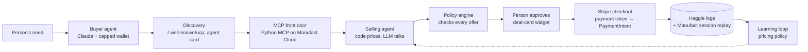

# Architecture

> Started from the whiteboard session on 2026-10-17 and updated as experiments and sponsor research land. Each layer is marked **Decided**, **Leaning**, or **Open**, with the evidence behind it. The [change log](#change-log) records what changed and why. The same content is on the architecture page (`docs/architecture.html`).

## Components

| Layer | Status | Current design | Evidence | Still open |
|---|---|---|---|---|
| **Buyer agent** | Decided for the demo | Claude with a persona (need, budget, private walk-away). Its wallet enforces the person's spend cap and asks for approval, then mints a Stripe token capped at the deal total (simulated in test mode). | E1: real Claude buyers completed 24/24 feasible purchases, 0 tool errors. E3: buyers counter 100% of the time when they can. | Buyers leak their budget often (E1: 11 of 20 in one group). |
| **Discovery** | Leaning | `/.well-known/ucp` listing our MCP endpoint, plus an A2A agent card and `llms.txt`. We propose a "negotiable" field, since no standard has one. | E8: UCP is the one live standard pointer from a seller's domain to its MCP server; no shopping agent reads A2A cards today. | Real routing to seller endpoints is a distribution problem the harness can't test. |
| **Agent-to-agent haggle** | Decided | Runs over MCP tool calls with structured offers. State travels in a server-minted `negotiation_id` passed back on every call. Round cap with a final buyer turn to accept. Not using Google's A2A protocol in v1. | E1: structured tools 0 errors vs. 1 for free text, 58 s vs. 79 s. E2: deals lost when the cap ended on the seller's turn. MCP spec 2026-07-28 has no sessions. | E3 model comparison (do Sonnet and Haiku buyers behave the same?). |
| **MCP front door** | Decided | Official Python MCP SDK 2.3, stateless Streamable HTTP, hosted on Manufact Cloud (`--runtime python`). Tools: `list_products`, `get_product`, `make_offer` (structured price and add-ons plus an optional message), `accept_offer`, `review_deal` (deal-card widget), `pay_deal`. `request_quote` dropped: the first offer returns the opening quote. Titles, safety annotations, typed outputs, short results. No login tonight; payment is gated by the token cap and human approval. Armature MCP Analytics on the live server judges real sessions (it adds a `telemetry` field to every tool, so we A/B it first). | E1: 116 real buyers, 0 invalid arguments, nobody called `request_quote`; free-text messages earned $499 more per deal. Manufact guide: mcp-use's Python package needs MCP < 2.0 and has no widgets; Manufact's CTO documents this exact Python setup. Armature guide: annotations, idempotent payment, short receipts. | Do Manufact judges want mcp-use itself? Gateway timeout vs. 10–30 s seller turns. |
| **Selling agent** | Decided | Concede slowly on a Boulware schedule (t³ from list toward floor), offering the warranty before discounting. Code computes each round's target and the true reason; the LLM voices it; the policy engine holds the floor. Hold list when the buyer can clearly pay it; guard add-on margin; no "best price" bluffs; never call a price firm unless it's the final offer; no quote-matching rules. | E5: Boulware in the prompt $8,870 per session vs. $7,668 default negotiator (+15.7%), same conversion; bundle-first $8,464; fixed price $7,807 beat the default negotiator. E2: negotiating seller +54% profit per session over a static page, but 0 of 42 deals at list and margin down from 28.8% to 20.1%. E7: in a four-seller market the negotiating seller won 57.5% of deals, fixed-price sellers sold nothing, and a beat-any-quote rule got exploited. E6 phase 1: split-the-difference is the best fixed strategy on scripted buyers. | E6: can a learned policy beat $8,870 per session against LLM buyers? |
| **Policy engine** | Decided (prices), Open (words) | Plain code. Checks every seller offer before it goes out, and again at `pay_deal`. Floors, allowed add-ons, payment terms. | E2: blocked 8 below-floor attempts; 0 closed deals broke a rule. E1: blocked an Opus seller accepting $29,200 against a $29,700 floor. | E4: do sellers promise financing or freebies in words, which a price check can't catch? |
| **Guardrails (cross-cutting)** | Leaning | Input: buyer text quoted as untrusted data, injection detector, schema-checked offers. Decision: strategy/RL actions masked so nothing below the low can be proposed; optionally the LLM never sees the low or cost. Output post-guard on every seller turn: policy engine, prices in text must match a valid offer and stay above the low, no floor disclosure, no verbal financing or freebies, "final" only when final; block → regenerate → safe template. Transaction: immutable deals; `pay_deal` rejects tampering, replays, expiry, under-capped tokens. Session: concession cap, circuit breaker, human escalation. | E1: engine stopped an Opus below-floor accept. E2: seller revealed its floor twice. E1/E5: "best and final" bluffs. | E9 measures each layer and its cost to legitimate sales. |
| **Checkout** | Decided | Deal stored when approved → buyer sends a Shared Payment Token capped at the exact total → `pay_deal` re-checks the policy and the token's cap, currency, and expiry → PaymentIntent with an idempotency key. The amount always comes from our stored deal. Fallback: PaymentIntent with a test card. | Stripe guide: this is Stripe's documented seller flow; their Aug 2026 marketplace post describes the same policy-engine-before-payment design. | Payment token is a preview API: 10-minute go/no-go test first. Buyer-side token is simulated in test mode. |
| **Learning loop** | Open | Policy picks discrete moves (hold, concede 5/15/35% of the gap, add warranty, final offer, accept, walk). Reward: profit on a deal, 0 on a walk-away, a penalty below that for engine-rejected proposals. Train offline on scripted buyers, test on LLM buyers. Data: our logs and Manufact session replays (payload capture on). | E6 phase 1: learned $6,353 vs. best fixed $6,405 profit per buyer (scripted); a seller that knew each walk-away would make $8,141. | E6 phase 2: does learning beat fixed strategies against LLM buyers? |
| **Evals and agent experience** | Decided | Our harness (completion, tool errors, rounds, agent vs. page, buyer models) plus Armature Evals: tester agents run goal cases against our deployed URL and a judge scores them 0–5 (no SDK needed). Armature Analytics judges real sessions; its buyer telemetry never reaches the selling agent. | E1, E2, E3; Armature docs checked 2026-10-17. | Evals are enabled per workspace on request; free tier is 100 runs/month, 1 target per case. |

## End-to-end case: buying a tractor

1. **Need.** The person tells their buyer agent something like: "I need a compact tractor for a 20-acre property. Budget around $40k."
2. **Discovery.** The buyer agent finds the seller's MCP endpoint through `/.well-known/ucp` or the agent card.
3. **Front door.** It browses the catalog and asks for a quote. The server returns a `negotiation_id`.
4. **Haggle (one-to-one).** The buyer and the selling agent trade structured offers over several rounds, up to the round cap.
   - Buyer **B($$, ?)**: a budget it may reveal, and a walk-away price it keeps private.
   - Seller **S(H, L, $$)**: a list price H it anchors on, a floor L it can't go below, and its cost.
5. **Authorize.** Every seller offer passes the policy engine before the buyer sees it.
6. **Approve.** The agreed deal shows up in the deal-card widget, and the person approves it.
7. **Pay.** The buyer's wallet sends a Stripe payment token capped at the deal total; `pay_deal` charges it.
8. **Learn.** The transcript and outcome go into the logs, and the pricing policy learns from them.

## What the seller optimizes

From the board: **{conversion rate, profit, revenue}**. The working reward is profit per buyer session, with rule-breaking proposals scored below walking away (see [OPEN_QUESTIONS.md](experiments/OPEN_QUESTIONS.md), R1).

## Change log

| When | Layer | Change | Driven by |
|---|---|---|---|
| 2026-10-17 | Agent-to-agent haggle | Haggle runs over MCP tool calls; no Google A2A protocol in v1; agent card kept for discovery only. | E8 research |
| 2026-10-17 | Agent-to-agent haggle | Structured offer tools over a free-text `negotiate` tool. | E1 |
| 2026-10-17 | Selling agent | Added: hold list for buyers who can pay it, add-on margin guard, ban "best price" bluffs. | E2 |
| 2026-10-17 | Agent-to-agent haggle | Buyer gets a final turn to accept at the round cap. | E2 |
| 2026-10-17 | MCP front door | Keep the official Python MCP SDK and host it on Manufact Cloud instead of porting to mcp-use. | Manufact guide |
| 2026-10-17 | MCP front door | `negotiation_id` handle, tool annotations, idempotent payment, short receipts, discovery files. | Armature guide |
| 2026-10-17 | Checkout | Mock checkout replaced by Stripe payment token → PaymentIntent via `pay_deal`; deal-card widget for approval. | Stripe guide |
| 2026-10-17 | Learning loop | Reward scores rule-breaking below walking away; scripted buyers must walk away from stubborn sellers. | E8 research |
| 2026-10-17 | Selling agent | Never call a price firm or final unless it's the final offer. | E7 |
| 2026-10-17 | Selling agent | No quote-matching rules; buyers played quotes against each other until a seller hit its floor. | E7 |
| 2026-10-17 | Discovery | Broker / marketplace mode stays out of the build; buyers shop sellers themselves and a broker only cut price about 1 point. | E7 |
| 2026-10-17 | Guardrails | Made an explicit cross-cutting layer (input, decision, output post-guard, transaction, session); E9 tests each layer. | Safety review |
| 2026-10-17 | Selling agent | Seller priority (profit, conversion, adaptive) becomes a configuration; E10 tests it against buyer types. | Design review |
| 2026-10-17 | Selling agent | Strategy decided: slow Boulware concession with warranty-before-discount; code computes the target and true reason, the LLM voices it. | E5 |
| 2026-10-17 | Selling agent | Fixed price is the baseline to beat; the default negotiator earned less than fixed price. | E5 |
| 2026-10-17 | Front door | `request_quote` dropped (unused in 116 runs); `make_offer` keeps an optional message since free text earned the seller $499 more per deal. | E1 |
| 2026-10-17 | Policy engine | Confirmed as required: it stopped a below-floor accept from an Opus seller. | E1 |
| 2026-10-17 | Discovery | Armature removed from this layer: its discoverability product measures which dev tools coding agents pick; it isn't a discovery channel. | Sponsor docs check |
| 2026-10-17 | Front door | Stay on the official Python MCP SDK: Armature's SDK supports it (mcp-use isn't listed) and Manufact Cloud hosts Python. Ask Manufact whether mcp-use is expected. | Sponsor docs check |
| 2026-10-17 | Evals | One job per sponsor: Manufact builds, hosts and publishes; Armature judges and evaluates AX; Stripe moves money. | Sponsor docs check |

The experiment list is in [EXPERIMENTS.md](experiments/EXPERIMENTS.md) and the track plan in [TRACKS.md](TRACKS.md).
