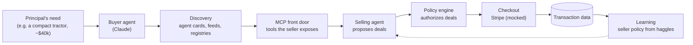

# Architecture

> From the whiteboard session on 2026-10-17. This is the setup our experiments assume. It will change as results come in.

## Components

| Component | What it does | In our experiments |
|---|---|---|
| **Buyer agent** | Acts for a person who needs something. Gets a prompt with the need, a budget, and constraints. | Claude through headless `claude -p`. Each persona has a stated budget and a private walk-away price. |
| **Discovery** | How the buyer finds sellers: agent cards, product feeds, registries. | A local registry file that lists seller agent cards. |
| **MCP front door** | The seller's endpoint. Exposes tools to the buyer: catalog, quote, offer, accept, checkout. | A FastMCP server in Python. |
| **Selling agent** | Negotiates for the seller and proposes deals. | An LLM, optionally driven by a fixed strategy or a learned policy that picks the price. |
| **Policy engine** | Checks every proposed deal against the seller's rules and rejects anything outside them. | Plain code: price floor, max discount, allowed add-ons, payment terms. |
| **Checkout** | Turns an agreed deal into a payment. | Mocked Stripe checkout. We assume the payment succeeds. |
| **Learning** | Uses haggling transcripts to improve the seller's policy, with a reward built from conversion, profit, and revenue. | Bandits and Q-learning against simulated buyers, plus prompt-level learning from transcripts. |

## End-to-end case: buying a tractor

1. **Need.** The principal tells their buyer agent something like: "I need a compact tractor for a 20-acre property. Budget around $40k."
2. **Discovery.** The buyer agent looks up sellers in a registry, reads their agent cards, and finds each seller's MCP endpoint.
3. **Front door.** It connects to a seller's MCP endpoint, browses the catalog, and asks for a quote.
4. **Haggle (one-to-one).** The buyer and the selling agent go back and forth over several rounds (the board says >10; we set a turn cap).
   - Buyer **B($$, ?)**: a budget it may reveal, and a walk-away price it keeps private.
   - Seller **S(H, L, $$)**: a list price H it anchors on, a floor L it can't go below, and its cost.
5. **Authorize.** The selling agent proposes a deal and the policy engine approves or rejects it.
6. **Match and pay.** When both sides agree, the deal goes to checkout through Stripe. In experiments we assume this step works.
7. **Learn.** The transcript and the outcome go into the transaction log, and the seller's policy learns from it.

The marketplace version is the same, except the buyer talks to a set of sellers (for example through Inkbox) instead of just one.

## What the seller optimizes

From the board: the seller's policy is judged on **{conversion rate, profit, revenue}**. The working reward is defined in [OPEN_QUESTIONS.md](experiments/OPEN_QUESTIONS.md) (R1).

## Experiment tracks

The board splits experiments into three tracks. We added learning as a fourth.

1. **General:** does the basic setup work at all? End to end, the front door, safety.
2. **Buy–sell:** one buyer, one seller, haggling.
3. **Marketplace:** one buyer, many sellers. Endpoints and dynamic pricing.
4. **Learning:** can the seller get better at haggling from its own transaction data?

The full experiment list is in [EXPERIMENTS.md](experiments/EXPERIMENTS.md).
